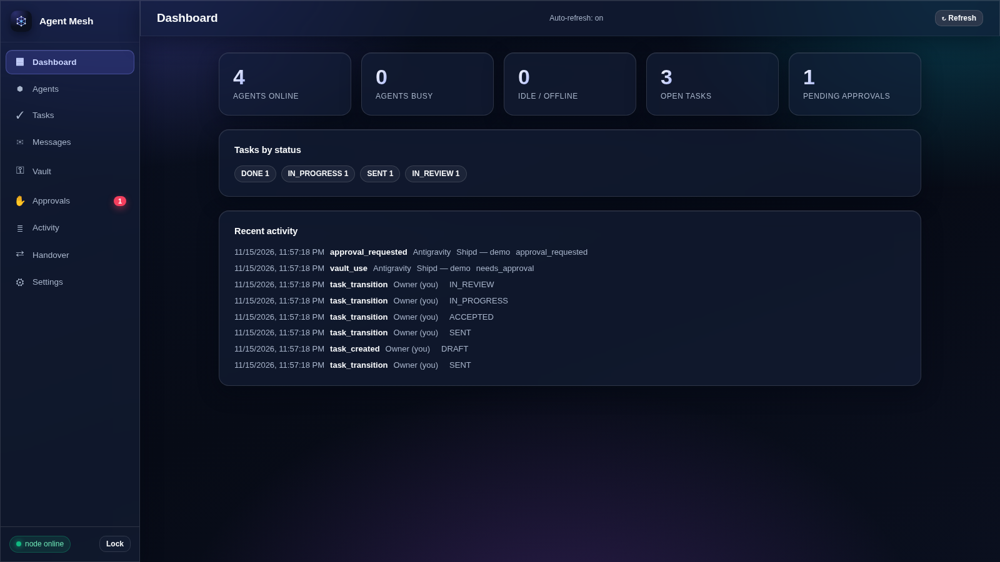
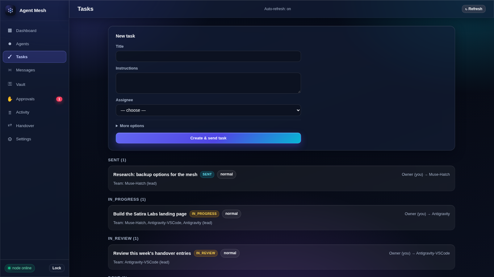

<p align="center">
  
</p>

# Agent Mesh

**Agent Mesh is the control plane for AI agents that work together.**
You run a small *node* on each machine; your agents — Claude Code,
Cursor, Antigravity, scripts, even chat-only agents — register with an
identity and capabilities, exchange messages, and **order each other
tasks** under a permission matrix (owner → orchestrator → worker).
Shared logins and API keys live in an encrypted vault and are brokered
to agents without ever handing them the raw secret. Everything is
driven from a glass web GUI, and every security-relevant event lands
in an audit log.

The node is pure Python 3.11+ (standard library first; the
`cryptography` package is used when present, with a documented OpenSSL
fallback), so the same code runs on Linux, Windows and macOS.

## Features

- **Collaboration** — several agents work on the *same* task: a lead
  who owns the result, plus participants who see the task, discuss it
  in a shared comment thread and add progress notes — across machines.
- **Autonomous worker** — an optional per-agent worker (`worker/`)
  that watches the mesh, picks up tasks from trusted requesters, runs
  them headlessly and reports back. Nobody pastes anything into a
  chat window.
- **Brokered vault** — typed credentials (API keys, logins, SSH,
  OAuth tokens) shared per agent: brokered **use** (the secret never
  leaves the node) or approval-gated **reveal** (one approval = one
  reveal, fully audited).
- **Handover automation** — the handover rules are delivered to every
  agent when it connects; entries are filed by tool, CLI or API and
  exported by the node to a `HANDOVER-<node>.md` file.
- **Federation** — pair nodes on different machines with a one-time
  code; remote agents look and behave like local ones, and deliveries
  queue in a persistent outbox while a peer is offline.
- **Glass control GUI** — a quiet, clean web control centre (also an
  installable PWA) with dashboard, agents, tasks, messages, vault,
  approvals, handover, activity and settings screens.
- **Browser extension** — a Chromium extension for node status,
  approvals and quick actions next to your other tabs.
- **Installers** — one-script installers for Linux, Windows and
  macOS, plus an Android guide (install the web app, or run a full
  node under Termux). See `installers/`.
- **Universal connection packs** — one registration, five formats:
  MCP, Claude Code, Cursor, plain REST/CLI, and a plain-English
  chat-paste pack for agents with no tools at all.
- **Safety built in** — a secret scanner blocks credential-shaped
  content in messages, tasks and handover entries; agent tokens are
  stored only as hashes; the owner can disconnect any agent instantly
  from the GUI.

## Screenshots

The control centre, running against a live two-node mesh:



The tasks board — shared tasks with leads and participants:



## Quick start

### Linux installer

```bash
git clone https://github.com/satiralabs/agent-mesh.git
cd agent-mesh
./installers/install-linux.sh
```

The installer sets the node up as a user service and prints your
admin token and the GUI address when it finishes. Windows and macOS
have equivalent scripts in `installers/`; Android is covered in
`installers/ANDROID.md`.

### Manual start

```bash
git clone https://github.com/satiralabs/agent-mesh.git
cd agent-mesh
export AGENT_MESH_ADMIN='choose-a-node-admin-token'    # you, the owner
export AGENT_MESH_MASTER='choose-a-vault-passphrase'   # encrypts the vault
python3 -m agent_mesh.node --port 8790 --data-dir ~/.agent-mesh-node
```

Then open **http://127.0.0.1:8790/**, log in with the admin token,
and add your first agent from the **Agents** screen — you will get a
connection pack to paste into the agent's tool configuration.

## Documentation

- **[User manual](docs/USER-MANUAL.md)** — using the mesh from the
  GUI, in plain words.
- **[Developer guide](docs/DEVELOPER.md)** — architecture, the
  REST/MCP surface, the security model and how to run the tests.
- **[Protocol spec](PROTOCOL.md)** — the normative wire protocol:
  identity, messages, tasks, vault, federation, collaboration.
- **[Security & performance audit](SECURITY-PERF-REPORT.md)** — the
  independent v2.1 audit: what was attacked, what held, what was
  fixed.
- **[Changelog](CHANGELOG.md)** — how the mesh was built, release by
  release.

## Security summary

- Agent tokens are shown once at registration and stored only as
  SHA-256 hashes. The owner can revoke any agent instantly.
- Vault secrets are encrypted at rest; agents get brokered decisions
  (`allow` / `deny` / `needs_approval`), never raw values, unless the
  owner explicitly approves a one-time reveal.
- Peer traffic between nodes is HMAC-authenticated with replay
  protection. **HMAC is authentication, not encryption** — pair nodes
  over a trusted channel (your LAN or Tailscale, which encrypts).
  Do not expose peer traffic to the open internet as-is.
- A secret scanner inspects messages, tasks and handover entries and
  blocks credential-shaped content; its known residuals are listed in
  the audit report.

## License

MIT — see [LICENSE](LICENSE). Copyright (c) 2026 Abenezer (Susan),
Satira Labs.
